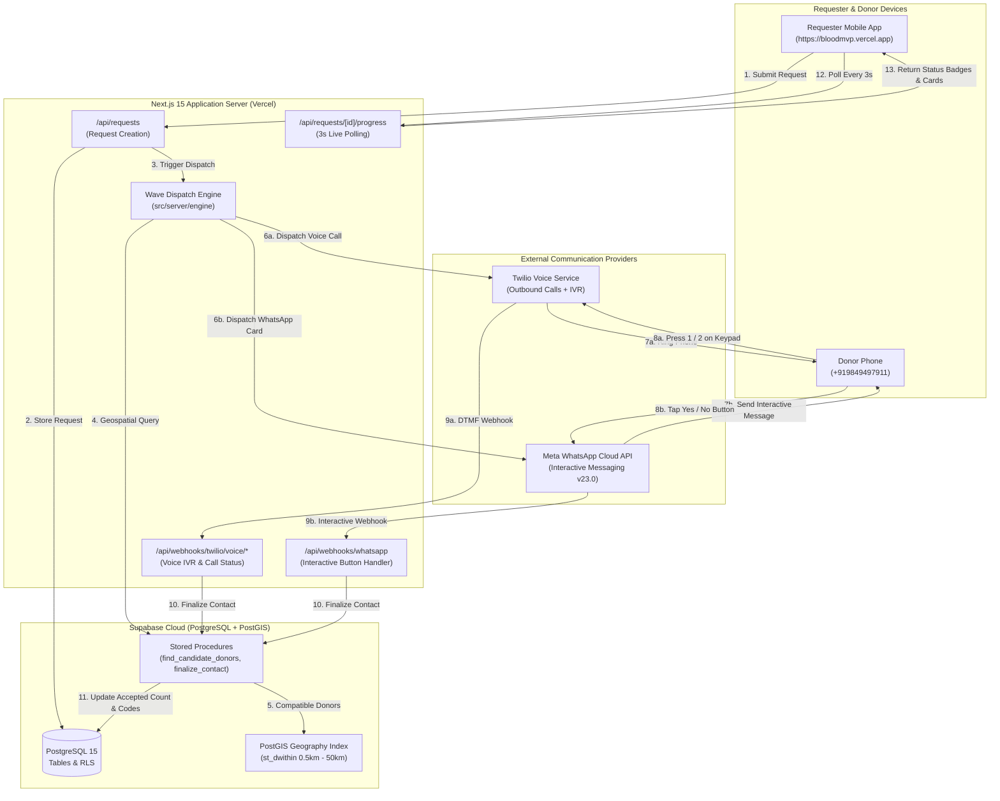
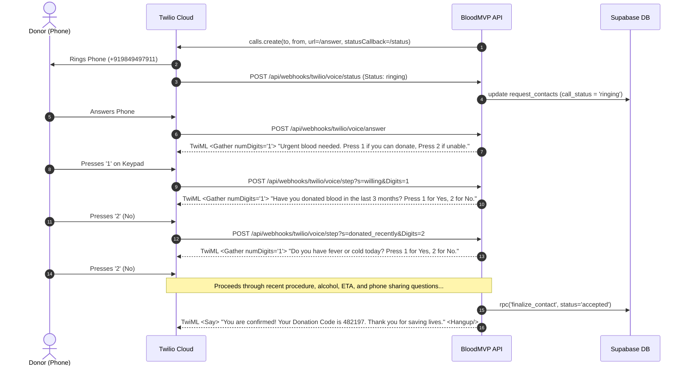
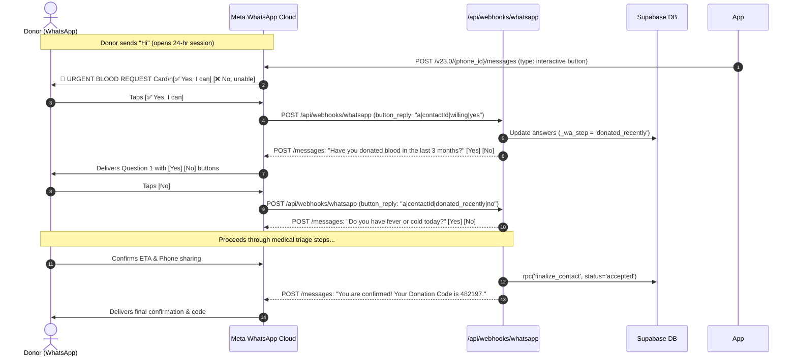

# BloodMVP — Architecture, Technologies & Integration Reference

> **Live Production URL:** [https://bloodmvp.vercel.app](https://bloodmvp.vercel.app)  
> **Supabase Project:** `yffjclzgracjbmqkjuon` (Organization: `BloodMVP`)  
> **Repository:** [https://github.com/Sivamani100/BloodMVP](https://github.com/Sivamani100/BloodMVP)

---

## 1. Executive Summary & Vision

**BloodMVP** is an emergency, real-time, hyperlocal blood donor matching and dispatch platform designed to solve critical delays in emergency blood procurement. When a patient needs urgent blood units, traditional manual calls to friends and blood banks cause dangerous delays.

BloodMVP automates this entire lifecycle:
1. **Hyperlocal PostGIS Matching:** Scans eligible registered donors in widening distance rings (0.5 km to 50 km) based on ABO compatibility, deferral periods, and fatigue limits.
2. **Dual Synchronous Outreach:** Concurrently triggers automated **Twilio Interactive Keypad Voice Calls (IVR)** and **Meta WhatsApp Interactive Question Cards** directly to candidate donors.
3. **Automated Medical Health Triage:** Guides donors through a structured 5-question health eligibility check (recent donation, fever/illness, surgery/vaccine, alcohol, hospital ETA) over keypad DTMF or interactive WhatsApp buttons.
4. **Fraud Prevention & Verification:** Generates a secure, cryptographically hashed 6-digit **Donation Code** that the donor presents at the hospital, enabling the requester to verify donation arrival without sharing personal phone numbers upfront.
5. **Real-Time Live Tracking Feed:** Provides requesters with a live 3-second polling command center showing call and message statuses, a 10-minute response timer, and donor arrival ETAs.

---

## 2. Technology Stack & Service Directory

| Category | Technology / Service | Role & Functionality | Official Documentation / Links |
| :--- | :--- | :--- | :--- |
| **Frontend Framework** | **Next.js 15.5** (App Router) | Server Components, Client Components, Edge Middleware, Route Handlers | [Next.js Docs](https://nextjs.org/docs) |
| **UI Library** | **React 19** | Declarative component architecture, hooks (`useState`, `useEffect`) | [React Docs](https://react.dev) |
| **Styling** | **Tailwind CSS v4** | Mobile-first responsive layout, medical emergency red/rose palette, micro-animations | [Tailwind CSS](https://tailwindcss.com) |
| **Icons** | **Lucide React** | High-contrast clinical and telecom status iconography | [Lucide](https://lucide.dev) |
| **Localization (i18n)** | **next-intl** | Trilingual support for English (`en`), Telugu (`te`), and Hindi (`hi`) | [next-intl Docs](https://next-intl-docs.vercel.app) |
| **Database & Auth** | **Supabase (PostgreSQL 15)** | Relational database, PostGIS spatial indexing, Row Level Security (RLS), Phone OTP Auth | [Supabase](https://supabase.com) |
| **Geospatial Engine** | **PostGIS** | `ST_DWithin`, `ST_Distance`, `ST_MakePoint`, `geography(Point, 4326)` | [PostGIS Docs](https://postgis.net) |
| **Voice Telephony** | **Twilio Voice API** | Outbound automated telephone calls, TwiML `<Gather>` IVR keypad DTMF recognition | [Twilio Voice Docs](https://www.twilio.com/docs/voice) |
| **Messaging** | **Meta WhatsApp Cloud API** | Direct WhatsApp Interactive Quick-Reply question cards and Template messages (v23.0) | [Meta WhatsApp Cloud API](https://developers.facebook.com/docs/whatsapp/cloud-api) |
| **Hosting & CI/CD** | **Vercel** | Serverless function deployment, Edge network, environment secret management | [Vercel](https://vercel.com) |
| **Testing Suite** | **Vitest & Playwright** | 47 unit & integration tests, 5 end-to-end browser smoke test suites | [Vitest](https://vitest.dev) · [Playwright](https://playwright.dev) |

---

## 3. High-Level System Architecture

The following diagram illustrates how the requester, matching engine, external communication providers (Twilio & Meta), and candidate donors interact:



---

## 4. Deep-Dive: The Engine & Matching Algorithm

The matching engine lives in [`src/server/engine/`](file:///c:/BloodMVP/src/server/engine) and operates across four strict medical safety pillars:

### 1. ABO Compatibility Matrix
Blood components have specific compatibility boundaries governed by `is_compatible(donor_group, patient_group, component)`:
- **Whole Blood / Red Cells:**
  - **O-** can donate to: All groups (Universal Donor).
  - **O+** can donate to: O+, A+, B+, AB+.
  - **A-** can donate to: A-, A+, AB-, AB+.
  - **A+** can donate to: A+, AB+.
  - **B-** can donate to: B-, B+, AB-, AB+.
  - **B+** can donate to: B+, AB+.
  - **AB-** can donate to: AB-, AB+.
  - **AB+** can donate to: AB+ only (Universal Recipient).
- **Platelets / Plasma:** Exact group match required.

### 2. Concentric Ring Expansion (`rings.ts`)
Outreach occurs in concentric distance rings:
$$\text{Rings (km)} \in [0.5, 1, 2, 3, 5, 10, 15, 20, 30, 40, 50, 70, 90, 100]$$

- **Contact Multiplier:** To fulfill 1 unit, the engine contacts **3 donors** ($\text{multiplier} = 3$). For 4 units, it seeks $4 \times 3 = 12$ candidates.
- **Dynamic Ring Widening:** If the narrow 0.5 km ring lacks enough candidate donors, the engine widens across inner rings (up to 5 km) in Wave 1 so all needed donors are alerted simultaneously.
- **10-Minute Response Window:** Each contact wave runs on a **10-minute timeout**. Donors who do not respond within 600 seconds are transitioned to `no_answer`, triggering the engine to evaluate ring expansion.

### 3. Medical Deferral & Fatigue Protection
- **3-Month / 4-Month Deferrals:** `compute_next_eligible(last_donation, gender)` enforces a mandatory 90-day cooldown for males and 120-day cooldown for females.
- **Fatigue Limits:**
  - Maximum **1 request per 6 hours**.
  - Maximum **3 requests per 7 days**.
  - Monthly donor cap respected (`max_requests_per_month`, default 4).
- **Active Commitment Lock:** A donor currently marked `accepted` or `on_the_way` for an active emergency cannot be alerted for another patient until that request is completed or closed.

---

## 5. Telephony Architecture: Twilio Interactive Voice (IVR)

The voice telephony system initiates outbound calls using Twilio's REST API and guides donors through a TwiML Interactive Voice Response (IVR) keypad survey.



### Voice Webhook Endpoints
1. [`/api/webhooks/twilio/voice/answer`](file:///c:/BloodMVP/src/app/api/webhooks/twilio/voice/answer/route.ts): Handles initial call connection and plays the introductory emergency prompt.
2. [`/api/webhooks/twilio/voice/step`](file:///c:/BloodMVP/src/app/api/webhooks/twilio/voice/step/route.ts): Evaluates keypad DTMF digits for each IVR state (`identity`, `willing`, `donated_recently`, `unwell_today`, `recent_procedure`, `alcohol_24h`, `eta`, `share_phone`).
3. [`/api/webhooks/twilio/voice/status`](file:///c:/BloodMVP/src/app/api/webhooks/twilio/voice/status/route.ts): Receives call lifecycle callbacks (`initiated`, `ringing`, `answered`, `completed`, `no-answer`, `busy`, `failed`) and updates contact statuses in the database.

---

## 6. Messaging Architecture: Meta WhatsApp Cloud API

The messaging integration uses Meta's official WhatsApp Business Cloud API (Graph API `v23.0`).

### 1. Two-Tier Communication Model
- **24-Hour Active Window:** When a donor has replied to the bot or initiated a chat within the last 24 hours, Meta allows direct interactive button messages (`type: "interactive"`).
- **Initial Cold Alert:** If outside the 24-hour window, the engine dispatches a pre-approved Meta Template with Quick Reply buttons (`urgent_blood_need_alert`).

### 2. Interactive Flow & Webhook Handshake



### 3. Inbound Webhook Features ([`whatsapp/route.ts`](file:///c:/BloodMVP/src/app/api/webhooks/whatsapp/route.ts))
- **Verification Handshake (`GET`):** Validates `hub.mode=subscribe` and `hub.verify_token` against `WHATSAPP_VERIFY_TOKEN`.
- **HMAC-SHA256 Signature Validation (`POST`):** Validates the `x-hub-signature-256` header against `WHATSAPP_APP_SECRET`.
- **Hybrid Parser:** Supports both structured button taps (`button_reply.id = "a|contactId|step|value"`) and natural typed text replies (`"yes"`, `"no"`, `"1"`, `"2"`), ensuring donors on older devices or customized clients can complete the survey.
- **Idempotency Guard:** Inserts `msg:${msgId}` into `webhook_events` to prevent duplicate processing on network retries.

---

## 7. Real-Time Tracking Screen UX (`/r/[requestId]`)

The live tracking screen at [`src/app/[locale]/r/[requestId]/page.tsx`](file:///c:/BloodMVP/src/app/[locale]/r/[requestId]/page.tsx) provides a real-time command center:

```
+-------------------------------------------------------------------+
|  < Request sent                                      EN      [X]  |
+-------------------------------------------------------------------+
|                     [ 0 of 4 accepted ]                           |
|                      ( Hospital Pin )                             |
|                   East Godavari, Rajahmundry                      |
+-------------------------------------------------------------------+
|  Donors who've accepted                                   0/4     |
|  O+ and compatible types                                          |
|                                                                   |
|  NEARBY DONORS CONTACTED (4)   [⏱ 08:34 left]   [● Live Dispatch] |
|  +-------------------------------------------------------------+  |
|  | (S)  Suresh  [O+]                              ( Calling... ) |  |
|  |      0.69 km away                                           |  |
|  |      💬 WhatsApp Alert: Delivered to phone                   |  |
|  +-------------------------------------------------------------+  |
|  | (S)  Siva  [O+]                              [ Can't Donate ]  |  |
|  |      Nearby in Rajahmundry                                [✕] |  |
|  +-------------------------------------------------------------+  |
|                                                                   |
|  [ Hide unable (1) ]                                              |
|                                                                   |
|                   ● ● ● Waiting for more donors...                |
|                                                                   |
|                  Finished or need to expand search?               |
+-------------------------------------------------------------------+
```

### Key UI Features
1. **Dynamic Real-Time Polling:** Polls `/api/requests/[id]/progress` every **3 seconds** for instantaneous state synchronization.
2. **Interactive Status Badges:**
   - **`Accepted` (Emerald):** Donor cleared health triage and agreed to donate.
   - **`Calling...` (Blue Animated Bounce):** Twilio phone call is currently dialing or ringing.
   - **`On Call...` (Violet Pulse):** Donor has answered and is currently on the line with the IVR assistant.
   - **`Call Ended` (Slate):** Phone call finished without the donor accepting.
   - **`No Answer` (Amber):** Call was missed, busy, or unlifted.
   - **`Can't Donate` (Rose):** Donor declined or indicated recent illness/donation.
   - **`Timed Out (10m)` (Gray):** Donor did not answer within the 10-minute wave response window.
3. **One-Click Dismiss & Filter Toggle:**
   - Requester can click the `✕` icon on any unable donor card to dismiss them from the view.
   - **"Hide unable" / "Show all"** button in the header toggles visibility of declined donors.
4. **Verification Field:** Once a donor accepts and arrives at the hospital, the requester inputs the donor's 6-digit code into the verification box to validate the donation and unlock the thank-you screen.

---

## 8. Database Schema & Security Model

The database schema is defined in [`supabase/migrations/0001_init.sql`](file:///c:/BloodMVP/supabase/migrations/0001_init.sql) and enforces strict privacy and Row Level Security:

### Core Tables
1. **`donors`:** Public profile data (first name, blood group, gender, reliability score, eligibility dates).
2. **`donor_private`:** Encrypted PII (full name, phone number, national ID, exact location). Accessible only via secure RPCs or server-side service role.
3. **`requests`:** Emergency request records (patient name, blood group, units needed, hospital PostGIS geometry, urgency level, status).
4. **`request_contacts`:** The audit log of every outreach attempt (call SID, WhatsApp message ID, call status, WhatsApp delivery status, eligibility answers JSONB, 6-digit donation code).
5. **`request_donor_cards`:** Sanitized view for the requester showing only accepted donors without exposing private phone numbers or street addresses.
6. **`webhook_events`:** Idempotency ledger preventing duplicate processing of Twilio and WhatsApp webhooks.

---

## 9. Environment Variables Reference

| Variable Name | Environment | Description |
| :--- | :--- | :--- |
| `NEXT_PUBLIC_SUPABASE_URL` | Client & Server | Supabase project API gateway |
| `NEXT_PUBLIC_SUPABASE_ANON_KEY` | Client & Server | Public Supabase anonymous client key |
| `SUPABASE_SERVICE_ROLE_KEY` | Server Only | Administrative secret for database operations and RLS bypass |
| `PUBLIC_APP_URL` | Server Only | Fully qualified app URL (`https://bloodmvp.vercel.app`) |
| `TWILIO_ACCOUNT_SID` | Server Only | Twilio Project Account SID |
| `TWILIO_AUTH_TOKEN` | Server Only | Twilio authentication token for REST API and signature checks |
| `TWILIO_FROM_NUMBER` | Server Only | Twilio registered phone number (`+12766248204`) |
| `WHATSAPP_PHONE_NUMBER_ID` | Server Only | Meta Cloud API Phone Number ID (`1383758468156268`) |
| `WHATSAPP_BUSINESS_ACCOUNT_ID` | Server Only | Meta WhatsApp Business Account (WABA) ID (`2870087486701819`) |
| `WHATSAPP_ACCESS_TOKEN` | Server Only | Meta Graph API Access Token (System User / Temporary) |
| `WHATSAPP_APP_SECRET` | Server Only | Meta App Secret for `x-hub-signature-256` HMAC validation |
| `WHATSAPP_VERIFY_TOKEN` | Server Only | Secret handshake token for webhook subscription |
| `OUTBOUND_ALLOWLIST` | Server Only | Safe phone numbers allowed for outreach during testing (`+919849497911`) |

---

## 10. Summary Checklist for Production Operations

- [x] **PostGIS Spatial Matching:** Active on Rajahmundry coordinates (`st_dwithin`).
- [x] **Twilio Outbound Calling:** Operational with TwiML IVR keypad gathering.
- [x] **Meta WhatsApp Messaging:** Subscribed and operational with interactive Yes/No question cards.
- [x] **Hybrid Inbound Parser:** Supports button taps and typed text responses.
- [x] **Live Tracking & 10m Timers:** Dynamic polling active with mobile-first status pills.
- [x] **Security & Allowlist:** Strict PII redaction and allowlist protections active.
- [x] **Test Suites:** 47 Vitest tests passing, 5 Playwright E2E browser tests passing.
